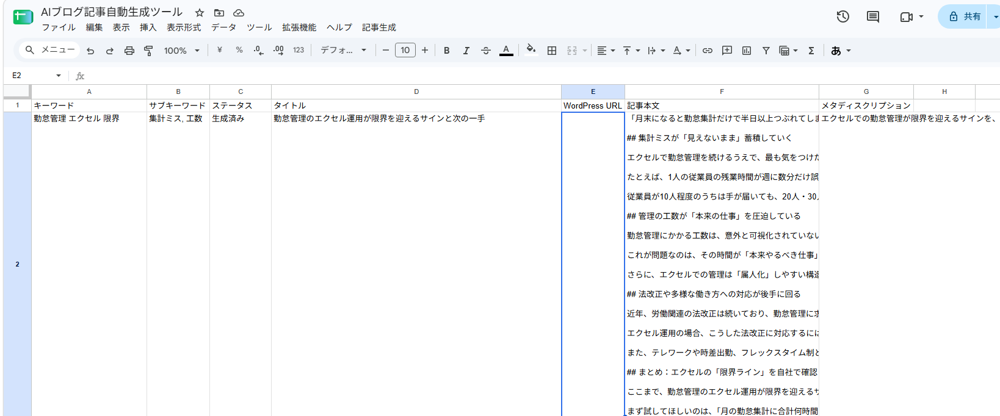
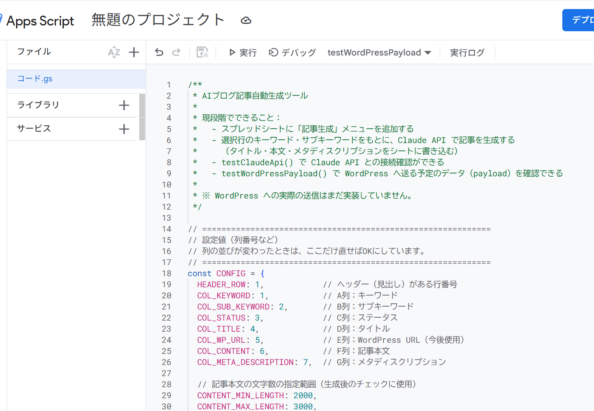
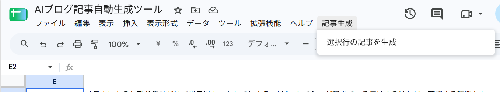

# AIブログ記事自動生成ツール

## 概要

GoogleスプレッドシートにSEOキーワードを入力すると、Claude API を利用して BtoB SaaS 向けの記事下書きを生成する Google Apps Script（GAS）ツールです。

- 想定媒体：クラウド勤怠管理ツール「キンタイ Cloud」のオウンドメディア
- 想定読者：中小企業の経営者・IT担当者
- 生成される記事は **人間が確認・編集する前提の下書き** です



*キーワードを入力して「選択行の記事を生成」を実行すると、C列が「生成済み」になり、D・F・G列にタイトル・記事本文・メタディスクリプションが書き出されます。*

> **WordPress について**
> 将来は WordPress REST API へ「下書き」として投稿する想定で設計していますが、
> **WordPress への実投稿は現在未実装です。**
> 今回の実装範囲は、**スプレッドシートへの記事書き出し** と、`testWordPressPayload()` による **draft（下書き）の送信データ確認** までです。

## ドキュメント

| ドキュメント | 内容 |
|---|---|
| [APIキー設定手順書](docs/api-key-setup.md) | Claude APIキーをスクリプト プロパティに設定する手順と、安全な管理ルール |
| [使い方マニュアル](docs/manual.md) | 記事を生成するまでの操作手順、ステータスの意味、再生成の方法 |
| [トラブルシューティング](docs/troubleshooting.md) | エラーが出たとき・うまく動かないときの対応方法 |
| [要件定義](docs/requirements.md) | 機能要件・記事仕様・実装範囲・既知の制限 |

## 主な機能

- 選択行のキーワード（A列）・サブキーワード（B列）の取得
- Claude API（モデル：`claude-sonnet-4-6`）による記事生成
- 本文 2,000〜3,000文字の記事（目標 2,200〜2,700文字）
- タイトル生成
- メタディスクリプション生成（120字以内をプロンプトで指示）
- C列のステータス管理（生成中／生成済み／生成エラー）
- 生成後の本文文字数チェック（範囲外なら警告を表示）
- 既存記事がある行を再生成するときの上書き確認
- エラー処理（エラー内容をダイアログと実行ログに表示）
- WordPress 用 payload の作成と確認（`testWordPressPayload()`）
- WordPress 下書き投稿を想定した設計（status は `draft` に固定）
- Claude API の接続テスト（`testClaudeApi()`）

## ファイル構成

| ファイル | 内容 |
|---|---|
| [`Code.gs`](Code.gs) | ツール本体（Apps Script に貼り付けて使用） |
| `README.md` | このファイル（概要・セットアップ・使い方） |
| [`docs/requirements.md`](docs/requirements.md) | 要件定義 |
| [`docs/api-key-setup.md`](docs/api-key-setup.md) | APIキー設定手順書 |
| [`docs/manual.md`](docs/manual.md) | 使い方マニュアル |
| [`docs/troubleshooting.md`](docs/troubleshooting.md) | トラブルシューティング |
| `images/` | ドキュメント用のスクリーンショット |

## シート構成

1行目は見出し行です。2行目以降に1行1記事で入力します。

| 列 | 項目 | 入力する人 |
|---|---|---|
| A | キーワード | 利用者（必須） |
| B | サブキーワード | 利用者（任意） |
| C | ステータス | ツールが自動で書き込み |
| D | タイトル | ツールが自動で書き込み |
| E | WordPress URL | 現在は未使用（将来の WordPress 連携用） |
| F | 記事本文 | ツールが自動で書き込み（Markdown形式） |
| G | メタディスクリプション | ツールが自動で書き込み |

## ステータス

| ステータス | 意味 | 誰が設定するか |
|---|---|---|
| 未生成 | まだ記事を生成していない | 利用者が手入力（空欄のままでも可） |
| 生成中 | Claude API で記事を生成している最中 | ツール |
| 生成済み | 記事の生成とシートへの書き込みが完了 | ツール |
| 生成エラー | 生成の途中でエラーが発生した | ツール |

※ ツールが「未生成」を自動で書き込むことはありません。
※ 「投稿済み」は WordPress 実送信を実装する段階で使う想定のため、現在は使用しません。

## セットアップ方法

1. **Googleスプレッドシートを用意する**
   1行目に見出し（A〜G列：キーワード／サブキーワード／ステータス／タイトル／WordPress URL／記事本文／メタディスクリプション）を入力します。
2. **Apps Script に Code.gs を設定する**
   スプレッドシートのメニュー「拡張機能」→「Apps Script」を開き、`Code.gs` の中身をすべて貼り付けて保存します。

   

3. **Script Properties（スクリプト プロパティ）に APIキーを設定する**
   Apps Script の「プロジェクトの設定」（歯車アイコン）→「スクリプト プロパティ」→「スクリプト プロパティを追加」で、次のように登録します。
   - プロパティ：`CLAUDE_API_KEY`
   - 値：ご自身の Claude API キー

   画面付きの手順は [APIキー設定手順書](docs/api-key-setup.md) を参照してください。
4. **スプレッドシートを再読み込みする**
   画面上部に「記事生成」メニューが表示されれば準備完了です。

> APIキーは `Code.gs` やドキュメントには書かず、必ずスクリプト プロパティに保存してください。

初回の実行時に Google から権限の承認を求められます。画面の案内に従って許可してください。

## 使用方法

```
① A列にキーワード、B列にサブキーワードを入力
      ↓
② 記事を生成したい行のセルを選択
      ↓
③ メニュー「記事生成」をクリック
      ↓
④「選択行の記事を生成」をクリック
      ↓
⑤ Claude API で生成（C列が「生成中」→「生成済み」に変わる）
      ↓
⑥ 完了ダイアログでタイトル・文字数を確認
      ↓
⑦ D・F・G列の内容を人間が確認・編集
```



詳しい操作は [使い方マニュアル（docs/manual.md）](docs/manual.md) を参照してください。

## WordPress 連携について

**WordPress への実投稿は現在未実装です。** 今回はスプレッドシートへの記事書き出しまでを実装しています。

WordPress 連携については、`testWordPressPayload()` で **draft（下書き）の送信データを確認するところまで** を実施しました。
Apps Script エディタで `testWordPressPayload()` を実行すると、選択行の D・F・G列から、将来 WordPress に送る予定のデータを作成して実行ログに表示します（**WordPress には送信しません**）。

```
{
  title,            // D列：タイトル
  content,          // F列：記事本文（Markdownのまま）
  status: "draft",  // 下書き（固定）
  excerpt           // G列：メタディスクリプション
}
```

- **status は必ず `draft`（下書き）です。** `draft` 以外になっているとエラーで停止します。
- この関数はシートに何も書き込みません（ステータスも変更しません）。
- 実行ログに `status：draft` と表示されても、それは **送信予定のデータの確認結果** であり、WordPress に投稿されたわけではありません。
- 実行ログの確認手順と表示例は [使い方マニュアル](docs/manual.md#wordpress-について) を参照してください。
- 将来の送信先は `https://example-saas.co.jp/wp-json/wp/v2/posts`（例示）、認証は WordPress のアプリケーションパスワードを想定しています。認証情報はまだ設定していません。

## 注意事項

- **AI生成記事は必ず人間が確認・編集してください。** そのまま公開しないでください。
- **法律や制度に関する記述は、公開前に最新情報を確認してください。**
- **APIキーを GitHub 等へ公開しないでください。** ログやスクリーンショット、チャットへの貼り付けにも注意してください。
- 記事本文（F列）は現在 **Markdown形式**（見出しは `## `）です。
- **WordPress への実投稿は今回の実装範囲外です。**
- **開いているシートが処理対象になります。** 記事管理用のシートを開いた状態で実行してください。
- 複数行を選択した場合は、**一番上の1行だけ** が処理されます。
- **「生成中」のまま止まった場合は**、D・F列の状態を確認してから再実行してください。
- **再生成に失敗した場合**、以前の記事が D・F・G列に残ったまま、C列が「生成エラー」になることがあります。
- メタディスクリプションの120字以内はプロンプトでの指示のみで、ツール側では文字数をチェックしていません。

困ったときは [トラブルシューティング（docs/troubleshooting.md）](docs/troubleshooting.md) を参照してください。
