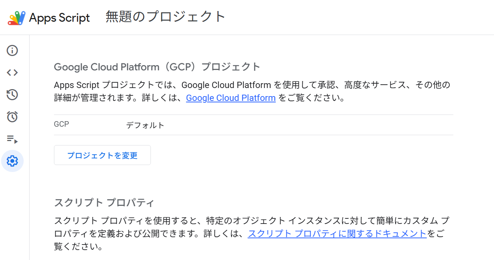
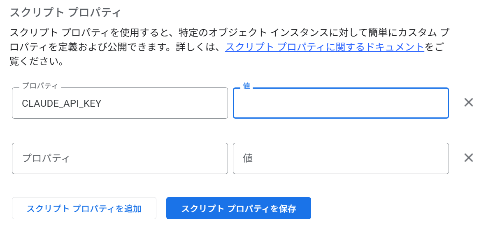

# APIキー設定手順書

このツールを使うには、**Claude APIキー** をスプレッドシートに登録する必要があります。
この手順書は、プログラムの知識がない方でも設定できるように書いています。所要時間は5分程度です。

---

## はじめに：APIキーとは

APIキーは、このツールが Claude（AI）を利用するための **「合い鍵」** です。
APIキーを知っている人は誰でも、あなたの契約で Claude を利用できてしまいます（利用料金もあなたに請求されます）。
**パスワードと同じように、厳重に管理してください。**

---

## 事前に用意するもの

- 記事生成ツールのスプレッドシート（編集権限があるもの）
- Claude APIキー（Anthropic 社の管理画面「Claude Console」で発行したもの）
  - APIキーの発行は、Claude の契約を管理している方に依頼してください

---

## 設定手順

設定は、次の流れで進めます。

```
Apps Script を開く
   ↓
プロジェクトの設定（歯車アイコン）
   ↓
スクリプト プロパティ
   ↓
CLAUDE_API_KEY を設定
```

### 手順1：Apps Script を開く

1. 記事生成ツールのスプレッドシートを開きます。
2. 画面上部のメニューから「**拡張機能**」をクリックします。
3. 「**Apps Script**」をクリックします。
4. 新しいタブで Apps Script の画面が開きます。

### 手順2：「プロジェクトの設定」を開く

1. Apps Script の画面の **左端** にあるアイコンの列を見ます。
2. **歯車のアイコン**（「プロジェクトの設定」）をクリックします。
   - アイコンにマウスを重ねると、名前が表示されます。



*左端の歯車アイコン（プロジェクトの設定）を選ぶと、この画面になります。下にスクロールすると「スクリプト プロパティ」があります。*

### 手順3：「スクリプト プロパティ」へ進む

1. 「プロジェクトの設定」の画面を、**一番下までスクロール** します。
2. 「**スクリプト プロパティ**」という項目があります。
3. 「**スクリプト プロパティを追加**」ボタンをクリックします。
   - すでに `CLAUDE_API_KEY` が登録されている場合は「**スクリプト プロパティを編集**」をクリックします。

### 手順4：CLAUDE_API_KEY を設定する

入力欄が2つ表示されるので、次のように入力します。

| 入力欄 | 入力する内容 |
|---|---|
| プロパティ | `CLAUDE_API_KEY` |
| 値 | 発行された Claude APIキー |

**入力時の注意**
- プロパティ名は **すべて半角・大文字** で、`CLAUDE_API_KEY` と正確に入力してください。
- APIキーをコピーするときは、**前後に空白や改行が入らないように**、全体を正確にコピーしてください。
- 入力したら「**スクリプト プロパティを保存**」をクリックします。



*「プロパティ」欄に `CLAUDE_API_KEY` と入力し、右の「値」欄にAPIキーを貼り付けます。この画像では、安全のため「値」欄は空欄の状態で撮影しています。*

> ⚠ 手順書やマニュアル用にスクリーンショットを撮るときは、**APIキーの値が写らないように** 隠してください。

### 手順5：設定を確認する（任意）

APIキーが正しく設定できたか確認したい場合は、次の手順で接続テストができます。

1. Apps Script の左端のアイコンから「**エディタ**」（`< >` のアイコン）をクリックします。
2. 画面上部の、関数名が表示されている欄で「**testClaudeApi**」を選びます。
3. 「**▶ 実行**」をクリックします。
4. 初めて実行するときは「承認が必要です」と表示されます。「権限を確認」→ Google アカウントを選択 →「許可」の順に進めてください。
5. 画面下の「**実行ログ**」に、次のように表示されれば設定完了です。

```
✅ 接続成功！Claudeからの返答：接続テスト成功
```

「Claude APIキーが見つかりません」と表示された場合は、手順3〜4をもう一度確認してください。
その他のエラーは [troubleshooting.md](troubleshooting.md) を参照してください。

---

## APIキーの安全な管理ルール

### ✅ APIキーは「スクリプト プロパティ」にだけ保存する

- このツールは、スクリプト プロパティに保存された `CLAUDE_API_KEY` を読み込んで使います。
- **APIキーを `Code.gs`（プログラム本体）に直接書かないでください。** コードをコピーしたり共有したりしたときに、キーも一緒に広まってしまいます。

### ❌ APIキーを GitHub にアップロードしない

- GitHub などのコード共有サービスにアップロードしたファイルは、公開設定によっては世界中の誰でも見られます。
- `Code.gs` やドキュメントにAPIキーが書かれていないことを、アップロード前に必ず確認してください。

### ❌ チャット・メール・スクリーンショットなどで不用意に共有しない

次のような場所に、APIキーを貼り付けたり写したりしないでください。

- チャット（Slack、Chatwork、Teams など）
- メール
- スクリーンショット、画面共有、録画
- 問い合わせフォーム、エラー報告
- 共有ドキュメント、スプレッドシートのセル

エラーを報告するときは、**エラーメッセージだけ** を共有してください。このツールはAPIキーをエラーメッセージや実行ログに出力しません。

### 🚨 APIキーが漏れた可能性があるとき

「うっかりチャットに貼ってしまった」「GitHub に上げてしまった」など、漏れた可能性がある場合は、**すぐに** 次の対応をしてください。

1. **Claude Console（APIキーを発行した管理画面）で、そのキーを無効化（削除）します。**
   - 自分で操作できない場合は、Claude の契約を管理している方にすぐ連絡してください。
2. **新しいAPIキーを発行します。**
3. **このツールのスクリプト プロパティ `CLAUDE_API_KEY` を、新しいキーに更新します。**（手順2〜4と同じ操作）
4. Claude Console の利用状況を確認し、身に覚えのない利用がないか確認します。

> 投稿やメッセージを削除しても、すでに誰かにコピーされている可能性があります。**削除だけで済ませず、必ずキーを無効化してください。**

---

## 参考：WordPress のアプリケーションパスワードについて（将来の実投稿用）

> **現在のツールは WordPress へ実際に投稿しません。そのため、WordPress の設定は現在は不要です。**
> 以下は、将来 WordPress への実投稿を追加する場合の管理方針です。

将来、WordPress へ下書きを投稿する機能を追加する場合は、WordPress の「**アプリケーションパスワード**」を使う想定です。
そのときは、Claude APIキーと同じルールで管理します。

- WordPress のユーザー名・アプリケーションパスワード・投稿先URLは、**スクリプト プロパティなどの安全な場所に保存し、`Code.gs` に直接書かない**
- アプリケーションパスワードは、WordPress へのログインパスワードとは別に発行する専用のパスワードです。**ログインパスワードをツールに登録しない**
- GitHub・チャット・メール・スクリーンショットなどで共有しない
- 漏れた可能性がある場合は、WordPress の管理画面（ユーザーのプロフィール画面）でそのアプリケーションパスワードを **無効化（取り消し）して再発行** する

具体的なプロパティ名や設定手順は、実投稿機能を追加する段階で、この手順書に追記します。
