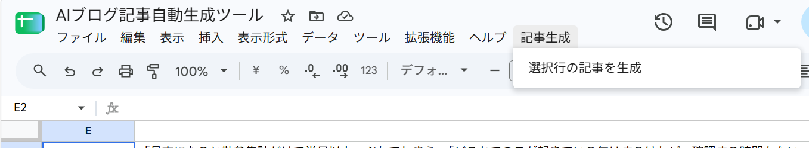
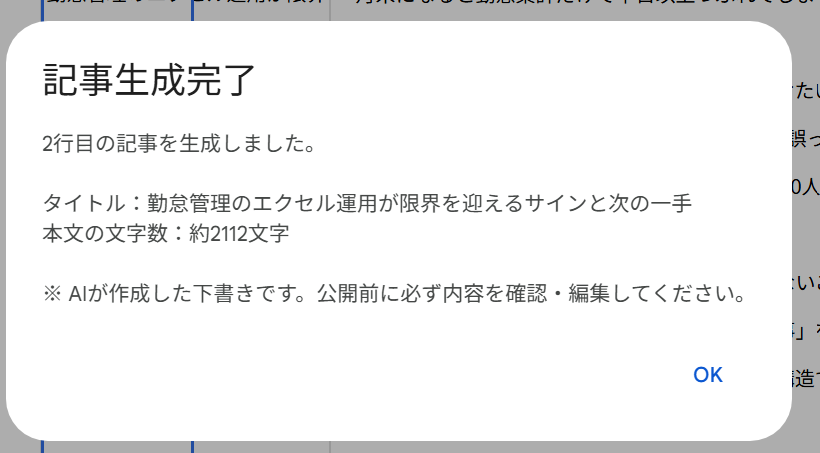
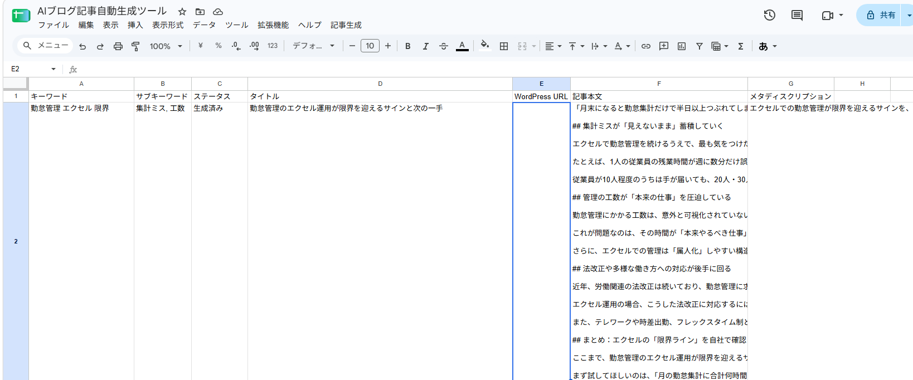
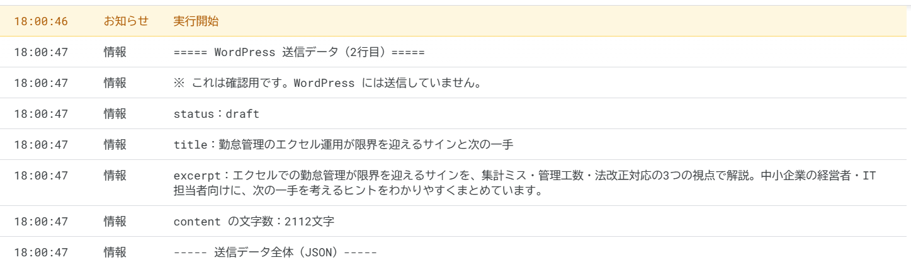

# 使い方マニュアル（AIブログ記事自動生成ツール）

毎週の記事作成（例：週3本）で使うための、最短手順をまとめたマニュアルです。
初めて使う前に、[APIキー設定手順書](api-key-setup.md) の設定が完了していることを確認してください。

うまく動かないときは [トラブルシューティング](troubleshooting.md) を参照してください。

---

## 基本操作（1記事あたり）

> 1回の操作で生成できるのは **1行＝1記事** です。3本作る場合は、この手順を3回くり返します。

### 準備：スプレッドシートを開く

記事生成ツールのスプレッドシートを開き、画面上部のメニューに「**記事生成**」が表示されていることを確認します。

- 表示されていない場合は、ページを再読み込みしてください（表示まで数秒かかることがあります）。
- 記事管理用のシートのタブが選ばれていることを確認します（**開いているシートが処理対象になります**）。

### 1. A列にキーワードを入力する

空いている行（2行目以降）の **A列** に、記事のメインキーワードを入力します。**必須** です。

例：`勤怠管理 エクセル 限界`

### 2. B列にサブキーワードを入力する

同じ行の **B列** に、一緒に含めたいキーワードを入力します。**空欄でも生成できます。**

例：`集計ミス, 工数`

### 3. 対象行を選択する

記事を生成したい行の、**どれか1つのセル** をクリックします。

- 1行目（見出し行）は選べません。
- 複数行を選択した場合は、**一番上の行だけ** が生成されます。

### 4. 「記事生成」メニューを開く

画面上部の「**記事生成**」をクリックします。

### 5. 「選択行の記事を生成」を押す

表示された「**選択行の記事を生成**」をクリックします。



- 初めて使うときは「承認が必要です」と表示されます。「続行」→ Google アカウントを選択 →「許可」の順に進めてください。
- すでに記事がある行を選んだ場合は、上書きの確認が表示されます（→「[記事を再生成する](#記事を再生成する)」）。

### 6. 生成完了まで待つ

C列が「**生成中**」に変わります。完了まで **数十秒〜1分程度** かかることがあります。
生成中は画面を閉じずにお待ちください。

完了すると「**記事生成完了**」のダイアログが表示されるので、「OK」を押します。



ダイアログには次の内容が表示されます。

- 生成した行番号
- タイトル
- 本文の文字数
- 文字数が範囲外の場合の警告（→「[文字数の目安](#文字数の目安)」）

### 7〜10. 生成結果を確認する

生成が終わると、選択した行が次のようになります。



| 手順 | 確認する列 | 確認すること |
|---|---|---|
| **7** | C列（ステータス） | 「**生成済み**」になっていること |
| **8** | D列（タイトル） | 記事タイトルが入っていること |
| **9** | F列（記事本文） | 導入・見出し（`## `）3つ・まとめの本文が入っていること |
| **10** | G列（メタディスクリプション） | 検索結果に表示される記事の要約が入っていること |

**F列の記事本文を読むときのコツ**
- 本文は **Markdown形式** です。`## ` で始まる行が見出し（H2）です。
- セルの中が見づらいときは、F列のセルを選択して、画面上部の数式バーを下に広げると読みやすくなります。

### 11. 人間が内容を確認・編集する

**生成された記事は下書きです。そのまま公開しないでください。**
必ず担当者が「[公開前のチェックリスト](#公開前のチェックリスト)」に沿って確認・編集してください。

---

## ステータス（C列）の意味

| ステータス | 意味 | すること |
|---|---|---|
| **生成中** | Claude が記事を作成している最中 | 完了まで待ちます |
| **生成済み** | 記事の作成とシートへの書き込みが完了 | D・F・G列を確認・編集します |
| **生成エラー** | 途中でエラーが起きて、記事を作成できなかった | ダイアログのメッセージを確認し、[トラブルシューティング](troubleshooting.md) を参照します |

- 生成前の行は、C列が空欄のままで問題ありません（管理用に「未生成」と手入力しても構いません）。
- 「生成中」のまま何分も変わらない場合は、[トラブルシューティング](troubleshooting.md#9-生成中のまま止まった) を参照してください。

---

## 文字数の目安

| 項目 | 想定する文字数 | ツールでのチェック |
|---|---|---|
| 記事本文（F列） | **2,000〜3,000文字** | あり（範囲外なら完了ダイアログに警告） |
| メタディスクリプション（G列） | **120文字以内** | なし（Claude への指示のみ） |

本文が範囲外のときは、完了ダイアログに次の警告が表示されます。

```
⚠ 文字数が指定範囲外です。内容を確認してください（指定範囲：2000〜3000文字）
```

- 警告が出ても、記事はシートに書き込まれ、C列は「生成済み」になります。
- 少しの過不足なら手で加筆・削除し、大きく外れている場合は再生成してください。
- シート上で文字数を確かめたいときは、空いているセルに `=LEN(F2)`（本文）や `=LEN(G2)`（メタディスクリプション）と入力します（`2` の部分は行番号）。
- 本文の文字数には、見出し記号（`## `）や改行も含まれます。

---

## 記事を再生成する

1. 再生成したい行のセルを選択します。
2. 「記事生成」→「選択行の記事を生成」を押します。
3. F列に本文がある場合は、次の確認が表示されます。

```
◯行目にはすでに記事本文があります。
再生成して上書きしますか？
```

- 「**はい**」：新しい記事で D・F・G列を上書きします。
- 「**いいえ**」：何もせずに終了します。

**注意**
- 上書きすると、以前の記事（手で編集した内容を含む）は消えます。残したい場合は、事前に別のシートなどにコピーしてください。
- 再生成に失敗した場合は、以前の記事が残ったまま C列が「生成エラー」になります。
- 再生成のたびに Claude の利用料金がかかります。

---

## 公開前のチェックリスト

- [ ] 内容に誤りがないか（特に **法律・制度・数値** は、公式の最新情報で確認する）
- [ ] 言い切りすぎた表現や、根拠のない表現がないか
- [ ] 「キンタイ Cloud」の機能や料金について、事実と違う記述がないか
- [ ] 他のサイトの記事とよく似た表現になっていないか
- [ ] キーワードが不自然に詰め込まれていないか
- [ ] タイトル・見出しが読者に分かりやすいか
- [ ] メタディスクリプションが120文字以内か
- [ ] 誤字脱字・表記ゆれがないか

---

## WordPress について

**現在のツールは、WordPress へ実際に投稿しません。**
WordPress へ記事を載せる場合は、確認・編集した記事を担当者が手作業で WordPress に登録してください。

将来の自動投稿に向けて、**WordPress へ送る予定のデータ（送信データ）を確認する機能だけ** があります。

### 送信データの確認方法（testWordPressPayload）

1. スプレッドシートで、記事を生成済みの行のセルを選択します。
2. 「拡張機能」→「Apps Script」を開きます。
3. 画面上部の関数名の欄で「**testWordPressPayload**」を選び、「**▶ 実行**」を押します。
4. スプレッドシートのタブに戻ると「WordPress送信データを作成しました。実行ログを確認してください。」と表示されるので、「OK」を押します。
5. Apps Script のタブに戻り、画面下の「**実行ログ**」を確認します。



*1行目の「実行開始」から順に、確認用のメッセージ・status・title・excerpt・本文の文字数が表示されます。これは **送信予定のデータを確認した結果** であり、WordPress に投稿されたわけではありません。*

実行ログでは、次の点を確認します。

- `status：draft`（下書き）になっていること
- タイトル（D列）、抜粋（G列のメタディスクリプション）、本文の文字数が表示されていること

この操作では、WordPress には何も送信されません。シートの内容やステータスも変わりません。

---

## 注意事項

- AIが作成した記事は、必ず人が確認・編集してから公開してください。
- 実行前に、記事管理用のシートを開いているか確認してください（開いているシートが処理対象です）。
- 1回の操作で生成されるのは1行だけです。
- APIキーは、チャット・メール・スクリーンショットなどで共有しないでください（→ [APIキー設定手順書](api-key-setup.md)）。
