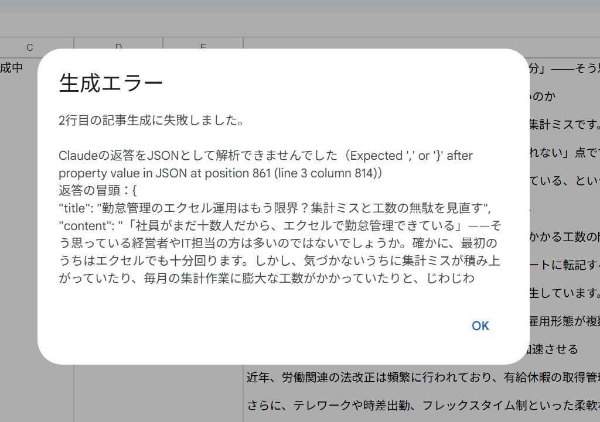

# トラブルシューティング

ツールがうまく動かないときの確認方法と対応をまとめています。
基本的な使い方は [使い方マニュアル](manual.md)、APIキーの設定は [APIキー設定手順書](api-key-setup.md) を参照してください。

> ## ⚠ エラー報告時の注意（秘密情報を共有しない）
> - **APIキー・パスワードを、エラー報告・チャット・メール・問い合わせ文・スクリーンショットに含めないでください。**
> - エラーを報告するときは、ダイアログや実行ログの **エラーメッセージだけ** を共有してください。このツールは、APIキーをエラーメッセージや実行ログに出力しません。
> - **スクリプト プロパティの画面** のスクリーンショットには、APIキーが写ってしまいます。撮影・共有しないでください。
> - APIキーが漏れた可能性がある場合は、すぐに Claude Console でキーを無効化し、再発行してください（→ [APIキー設定手順書](api-key-setup.md#-apiキーが漏れた可能性があるとき)）。

---

## 目次

| No. | 症状 |
|---|---|
| 1 | [実行時間6分超過](#1-実行時間6分超過) |
| 2 | [APIクォータ／レート制限](#2-apiクォータレート制限) |
| 3 | [WordPressに下書きが反映されない](#3-wordpressに下書きが反映されない) |
| 4 | [CLAUDE_API_KEY が見つからない](#4-claude_api_key-が見つからない) |
| 5 | [Claude APIエラー](#5-claude-apiエラー) |
| 6 | [JSON解析エラー](#6-json解析エラー) |
| 7 | [生成エラー（C列が「生成エラー」になった）](#7-生成エラーc列が生成エラーになった) |
| 8 | [本文が2,000〜3,000文字にならない](#8-本文が20003000文字にならない) |
| 9 | [「生成中」のまま止まった](#9-生成中のまま止まった) |
| 10 | [間違ったシートで実行した](#10-間違ったシートで実行した) |
| 11 | [既存記事を再生成したい](#11-既存記事を再生成したい) |

### エラーの確認場所

| 場所 | 確認できること |
|---|---|
| ダイアログ | 記事生成に失敗すると「生成エラー」ダイアログにエラー内容が表示されます |
| C列 | エラーになった行は「生成エラー」になります |
| Apps Script の「実行数」 | 「拡張機能」→「Apps Script」→ 左端の「実行数」（≡ に似たアイコン）で、過去の実行結果とログを確認できます |

---

## 1. 実行時間6分超過

**症状**
- Apps Script の「実行数」で、実行が **タイムアウト** や **失敗** になっている
- 「Exceeded maximum execution time」（実行時間の上限を超えた）などのメッセージが出る
- C列が「生成中」のまま変わらない

**原因**
Google Apps Script には、**1回の実行は最大6分まで** という制限があります。6分を超えると、処理が途中で強制終了します。

**対応**
- **1行ずつ処理してください。** このツールは、もともと1回の実行で1行（1記事）だけを処理する作りです。複数行を選択しても一番上の1行だけが処理されるため、1行ずつ実行してください。
- 時間をおいてから、同じ行でもう一度実行してください。Claude 側が混雑していると、生成に時間がかかることがあります。
- C列が「生成中」のまま残った場合は、「[9. 「生成中」のまま止まった](#9-生成中のまま止まった)」の手順で対応してください。
- 何度も発生する場合は、開発担当者に相談してください。

**補足**
6分に達する前に、Claude との通信が長くかかりすぎて **通信のタイムアウトエラー**（英語のメッセージ）になる場合もあります。対応は同じです。

---

## 2. APIクォータ／レート制限

**症状（例）**

```
Claude API エラー（HTTPステータス 429）
rate_limit_error：...
```

- クレジット残高・利用上限に関するメッセージ（HTTPステータス 400 など）が出る
- 「Service invoked too many times for one day: urlfetch」などのメッセージが出る

**原因**

| 種類 | 内容 |
|---|---|
| Claude のレート制限 | 短い時間に多くのリクエストを送ると、一時的に利用が制限されます（HTTPステータス 429） |
| Claude の利用上限・残高 | 契約で設定された月の利用上限に達した、またはクレジット残高が不足している |
| Google 側の上限 | Google Apps Script の外部通信（UrlFetch）には1日あたりの回数上限があります。週3本程度の利用で上限に達することは、通常ありません |

**対応**
1. **Claude 側の利用状況・制限を確認します。**
   - Claude Console（APIキーを発行した管理画面）で、利用状況・利用上限・請求（残高）を確認してください。
   - 自分で確認できない場合は、Claude の契約を管理している方に確認を依頼してください。
2. レート制限（429）の場合は、**1〜2分ほど待ってから** 再実行してください。続けて何度も実行しないでください。
3. 利用上限・残高不足の場合は、契約を管理している方に上限の見直しやチャージを依頼してください。
4. Google 側の上限の場合は、翌日まで待ってから実行してください。

---

## 3. WordPressに下書きが反映されない

> **現在のツールは、WordPress へ実際に投稿する機能を実装していません。**
> **そのため、現在の仕様では WordPress に下書きは反映されません。これは不具合ではありません。**

**現在できること**
- `testWordPressPayload()` で、WordPress へ送る予定のデータ（送信データ）を **実行ログで確認すること** だけです（手順は [使い方マニュアル](manual.md#wordpress-について) を参照）。
- WordPress に記事を載せる場合は、確認・編集した記事を担当者が手作業で登録してください。

**`testWordPressPayload()` でよく出るメッセージ**

| メッセージ | 原因 | 対応 |
|---|---|---|
| ◯行目のタイトル（D列）または記事本文（F列）が空欄です。… | まだ記事を生成していない行を選択している | 生成済みの行を選択するか、先に記事を生成してください |
| 1行目は見出し行のため処理できません。… | 1行目を選択している | 2行目以降の行を選択してください |
| 投稿ステータスが「draft」（下書き）ではありません… | `Code.gs` の設定（`WP_CONFIG.POST_STATUS`）が変更されている | 開発担当者に連絡し、`'draft'` に戻してもらってください |
| ダイアログが出ず、実行が終わらない | ダイアログがスプレッドシートのタブ側に表示されている | スプレッドシートのタブに切り替えて「OK」を押してください |

**将来、WordPress 実投稿を実装した場合の確認ポイント**

実投稿機能を追加したあとで下書きが反映されない場合は、次の点を確認します。

- **アプリケーションパスワードの権限**：発行したユーザーに、投稿を作成できる権限（「編集者」や「投稿者」など）があるか。パスワードが取り消されていないか
- **REST API の設定**：WordPress の REST API（`/wp-json/`）が有効か。セキュリティ系のプラグインやサーバーの設定で REST API や外部からのアクセスがブロックされていないか
- **認証情報の保存場所**：ユーザー名・アプリケーションパスワード・URLがスクリプト プロパティに正しく登録されているか（コードに直接書かない）
- **WordPress の下書き一覧**：投稿は「下書き」として登録されるため、公開済みの記事一覧ではなく **下書き** の一覧を確認する

---

## 4. CLAUDE_API_KEY が見つからない

**表示されるメッセージ**

```
Claude APIキーが見つかりません。
Apps Script の「プロジェクトの設定」→「スクリプト プロパティ」に
プロパティ名「CLAUDE_API_KEY」でAPIキーを保存してください。
```

**原因**
スクリプト プロパティに `CLAUDE_API_KEY` が登録されていないか、値が空です。

**対応**
[APIキー設定手順書](api-key-setup.md) の手順2〜4に沿って、次の点を確認してください。

- プロパティ名が **`CLAUDE_API_KEY`**（すべて半角・大文字）になっているか
- 名前の前後に空白が入っていないか、小文字になっていないか
- 値（APIキー）が入力され、保存されているか

---

## 5. Claude APIエラー

**表示されるメッセージ（例）**

```
Claude API エラー（HTTPステータス 401）
authentication_error：invalid x-api-key
```

HTTPステータスの番号で、原因の目安が分かります。

| HTTPステータス | 主な原因 | 対応 |
|---|---|---|
| 400 | リクエスト内容の問題、またはクレジット残高不足など | メッセージを確認します。残高・上限に関する内容なら「[2. APIクォータ／レート制限](#2-apiクォータレート制限)」を参照 |
| 401 | APIキーが間違っている、または無効になっている | スクリプト プロパティのキーを正しい値に更新します（コピー時の欠けや余分な空白に注意） |
| 403 | そのAPIキーに利用権限がない | 契約を管理している方に、キーの権限を確認してもらいます |
| 404 | モデル名や送信先が見つからない | 開発担当者に連絡してください（`Code.gs` の設定が変更されている可能性があります） |
| 429 | レート制限 | 「[2. APIクォータ／レート制限](#2-apiクォータレート制限)」を参照 |
| 500／529 | Claude 側の一時的な障害・混雑 | 時間をおいて再実行します |

**その他のメッセージ**

| メッセージ | 原因 | 対応 |
|---|---|---|
| 返答が最大トークン数（8000）に達し、途中で切れました。… | 記事が長くなりすぎて、返答が途中で切れた | 再実行してください。何度も発生する場合は開発担当者に相談してください |
| Claudeが返答を断りました。… | Claude が安全上の理由で返答を断った | キーワードの内容を見直して再実行してください |

---

## 6. JSON解析エラー

**表示されるメッセージ（例）**

```
Claudeの返答をJSONとして解析できませんでした（Expected ',' or '}' after property value in JSON ...）
```



*実際の表示例です。エラーメッセージの下に「返答の冒頭」として Claude の返答の最初の部分が表示されます（APIキーは表示されません）。*

```
Claudeの返答にJSONが見つかりませんでした。
```

```
Claudeの返答JSONに「metaDescription」がないか、空になっています。
```

**原因**
Claude の返答が、ツールで読み込める形（JSON形式）になっていませんでした。長い本文の中の記号（ダブルクォーテーションや改行など）が原因になることがあります。

**対応**
- **同じ行でもう一度実行してください。** 多くの場合、再実行で解決します。
- 同じキーワードで何度も発生する場合は、キーワードの表現を少し変えてみてください。
- それでも解決しない場合は、エラーメッセージを開発担当者に共有してください。

---

## 7. 生成エラー（C列が「生成エラー」になった）

**対応**
1. 表示されたダイアログのメッセージを確認します。見逃した場合は、Apps Script の「実行数」から確認できます。
2. メッセージに応じて、このページの該当する項目（4〜6など）を参照します。
3. 原因を解消したら、同じ行でもう一度「選択行の記事を生成」を実行します。

**注意**
- **再生成に失敗した場合は、以前の記事が D・F・G列に残ったまま「生成エラー」になります。** 表示されているのは前回の記事です。新しい記事と勘違いしないよう注意してください。
- エラーになった場合でも、Claude の利用料金が発生していることがあります。

---

## 8. 本文が2,000〜3,000文字にならない

**症状**
完了ダイアログに次の警告が表示されます。

```
⚠ 文字数が指定範囲外です。内容を確認してください（指定範囲：2000〜3000文字）
```

**原因**
Claude には2,000〜3,000文字（目標2,200〜2,700文字）で書くよう指示していますが、生成のたびに長さは多少ばらつきます。

**対応**
- 記事はシートに書き込まれ、C列は「生成済み」になっています。
- **少しの過不足なら、人が加筆・削除して調整する** のがおすすめです。
- 大きく外れている場合は、再生成してください（→「[11. 既存記事を再生成したい](#11-既存記事を再生成したい)」）。
- ツールが自動で作り直すことはありません。

**補足**
- 文字数には、見出し記号（`## `）や改行も含まれます。
- メタディスクリプション（G列）の120文字以内は、ツールではチェックしていません。`=LEN(G2)` などで確認してください。

---

## 9. 「生成中」のまま止まった

**原因**
処理が途中で強制終了すると、C列が「生成中」のまま残ります（「生成エラー」にもなりません）。
主に次のような場合に起こります。
- 実行時間の上限（6分）を超えた（→「[1. 実行時間6分超過](#1-実行時間6分超過)」）
- Apps Script の画面で実行を停止した

**対応**
1. Apps Script の「実行数」を開き、その実行の状態を確認します。
   - **実行中**：完了するまで待ちます。
   - **失敗／タイムアウト**：次の手順へ進みます。
2. その行の D・F・G列を確認します。空、または以前の記事のままなら、生成は完了していません。
3. 同じ行を選択して、もう一度「選択行の記事を生成」を実行します（F列に以前の記事がある場合は上書き確認が表示されます）。

---

## 10. 間違ったシートで実行した

**原因**
このツールは **今開いているシート** の選択行を処理します。記事管理用ではないシートを開いたまま実行すると、そのシートの C・D・F・G列に書き込まれます。

**対応**
1. 間違って書き込まれたシートの C・D・F・G列を確認し、元に戻します。
   - 直後であれば「元に戻す」（Ctrl + Z）で戻せる場合があります。
   - 戻せない場合は「ファイル」→「変更履歴」から、以前の状態を確認してください。
2. 記事管理用のシートのタブを選び直してから、もう一度実行します。

**予防**
実行前に、画面下部のシートのタブで、記事管理用のシートが選ばれていることを確認してください。

---

## 11. 既存記事を再生成したい

**対応**
1. 再生成したい行のセルを選択します。
2. 「記事生成」→「選択行の記事を生成」を押します。
3. 「再生成して上書きしますか？」と表示されたら「**はい**」を押します（「いいえ」を押すと何もせずに終了します）。

**注意**
- 上書きした以前の記事（手で編集した内容を含む）は元に戻せません。「ファイル」→「変更履歴」から確認できる場合はありますが、必要なら事前にコピーしておいてください。
- 再生成のたびに Claude の利用料金がかかります。

---

## それでも解決しない場合

開発担当者に、次の情報を共有してください。

- 実行した操作（どのメニュー・関数を実行したか）
- 対象の行番号
- 表示されたエラーメッセージ（そのままコピー）
- 実行した日時

> ⚠ **APIキー・パスワード・スクリプト プロパティの画面は、絶対に共有しないでください。**
